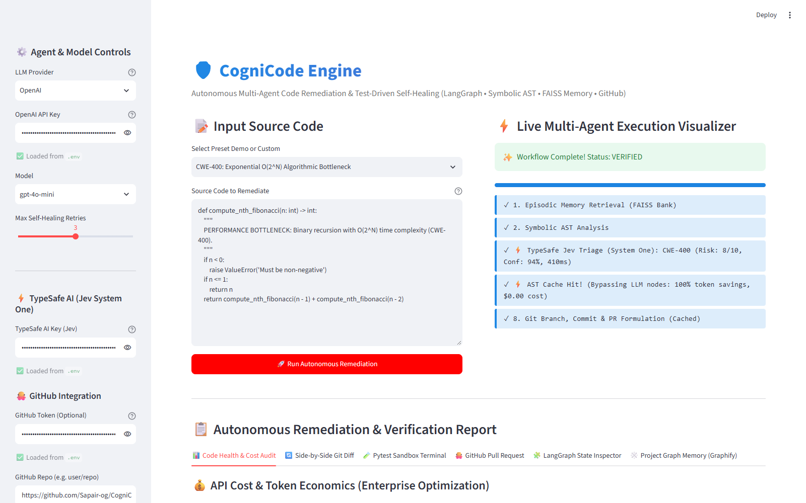
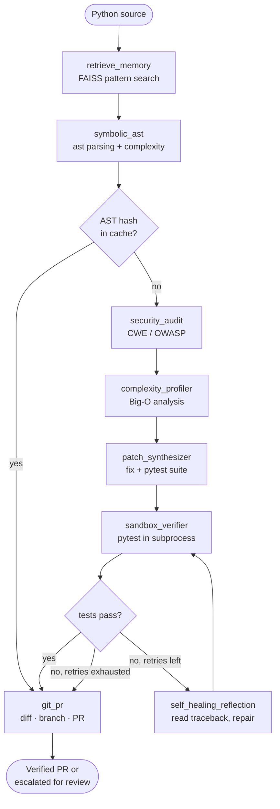
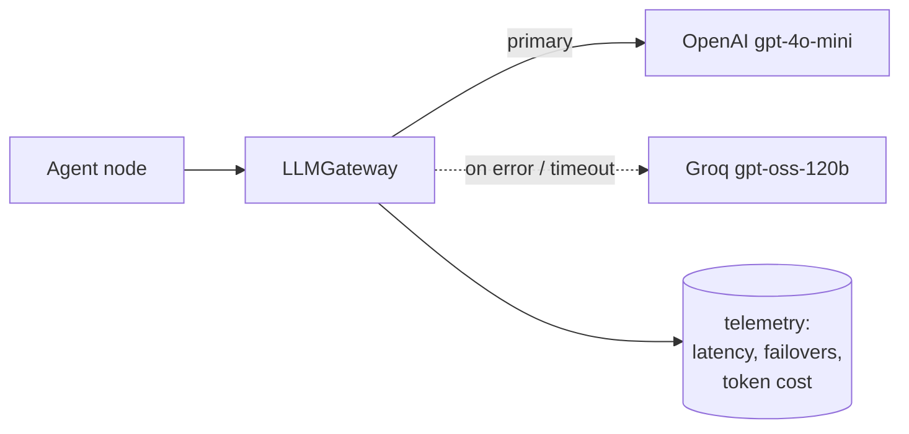
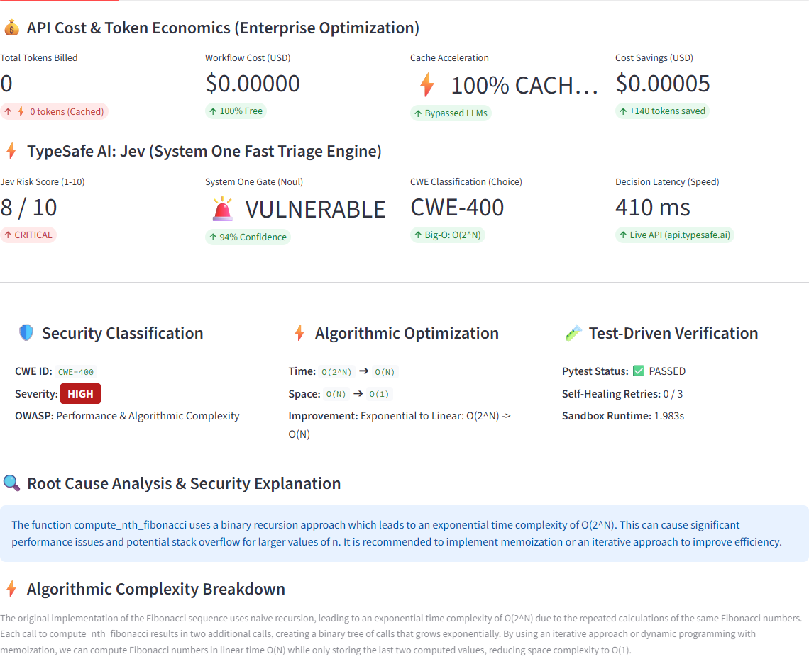
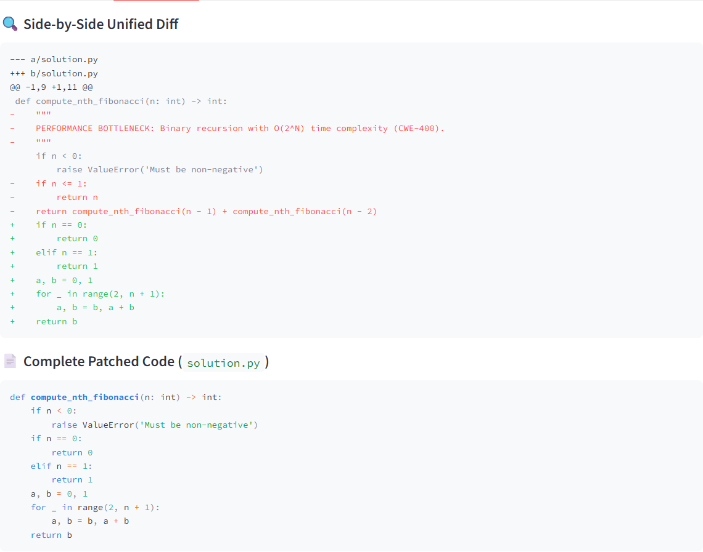
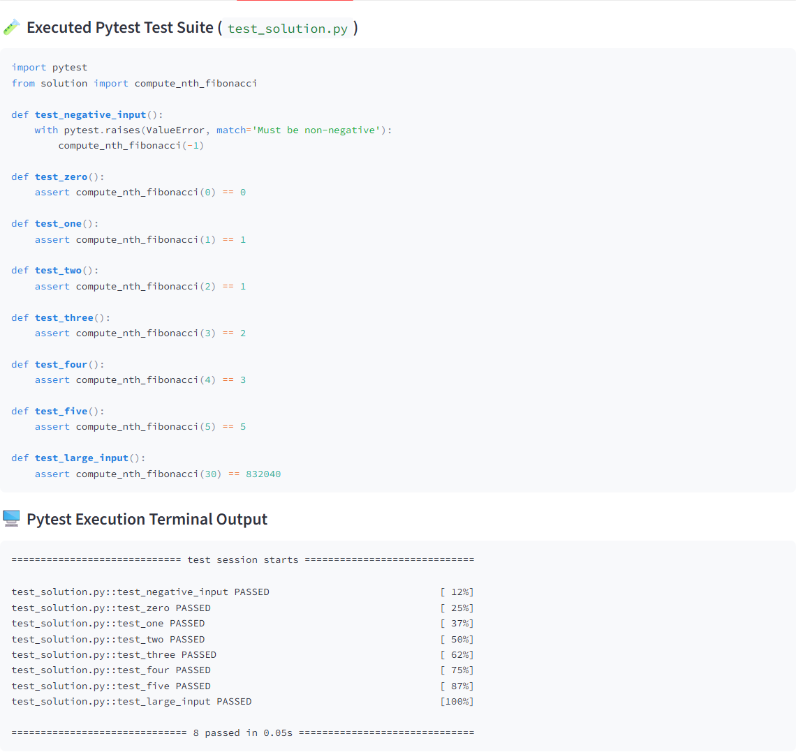
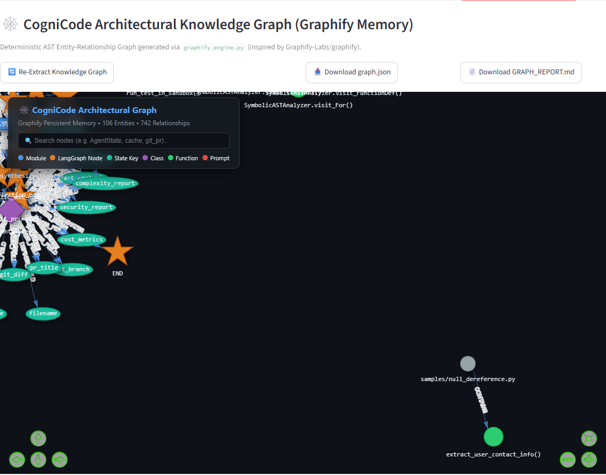

# CogniCode

**A multi-agent engine that finds bugs in Python code, writes a fix, proves the fix with generated tests, and opens a pull request.**

Built with LangGraph, Python's `ast` module, FAISS, pytest and the GitHub REST API. Streamlit dashboard on top.



---

## Why I built it

LLM code assistants are good at *suggesting* fixes but they don't check their own work. I wanted a pipeline where every patch has to pass tests before a human ever sees it, and where the cheap, deterministic checks (AST parsing, keyword triage, caching) run before the expensive LLM calls.

## What it does

1. **Retrieves similar past bugs** from a FAISS index of CWE remediation patterns (SQL injection, exponential recursion, null dereference, hard-coded secrets, `eval`, ...). These are used as few-shot examples.
2. **Parses the code with `ast`**: functions, imports, dangerous calls, cyclomatic complexity. No LLM involved.
3. **Checks a semantic cache** keyed on the SHA-256 of the normalised AST. If the same code was fixed before, it skips every LLM node.
4. **Security agent** classifies the vulnerability (CWE id, severity, OWASP category).
5. **Complexity agent** estimates time/space Big-O and proposes a better algorithm.
6. **Patch synthesizer** writes the fixed code *and* a pytest suite with edge cases.
7. **Sandbox** runs the tests in a temp directory in a subprocess with a timeout.
8. **Self-healing loop**: if tests fail, the traceback goes back to the LLM to repair the patch (max 3 retries, configurable).
9. **Git step** builds a unified diff and PR description, and can push a branch and open a real GitHub PR.

## Architecture



All nodes share one typed state object (`AgentState` in `src/state.py`). Each node returns only the keys it changes and LangGraph merges them. The two conditional edges live in `src/graph.py`.

### LLM gateway



`src/gateway.py` wraps every LLM call. If the primary provider throws, the same chain is retried on Groq, and the failover is counted. `src/cost_tracker.py` estimates tokens and USD cost per run, so the dashboard can show how much the cache saved.

### Retrieval (FAISS)

`src/memory.py` embeds each CWE pattern (title, description, keywords, vulnerable example) with a hashed bag-of-tokens + bigram embedding into 512 dimensions, L2-normalised, and stores the vectors in a `faiss.IndexFlatIP`. A query is ranked by `0.7 × cosine similarity + 0.3 × keyword-hit ratio`. The hashed embedding needs no model download, which keeps startup fast. Swapping in a sentence-transformer is a one-function change.

## Screenshots

| Audit report | Patch diff |
|---|---|
|  |  |

| Generated tests running in the sandbox | Codebase knowledge graph |
|---|---|
|  |  |

The example run above is the `CWE-400` preset: a naive recursive Fibonacci (O(2ⁿ)) rewritten as an O(n) loop, verified by 8 generated tests.

## Running it

```bash
git clone https://github.com/Sapair-og/CogniCode.git
cd CogniCode
python -m venv .venv
.venv\Scripts\activate          # Linux/macOS: source .venv/bin/activate
pip install -r requirements.txt

cp .env.example .env            # add OPENAI_API_KEY and/or GROQ_API_KEY
streamlit run app.py
```

Keys can also be pasted into the sidebar. `GITHUB_TOKEN` is only needed for the "open real PR" button.

Pick one of the presets (SQL injection, exponential recursion, two-sum + SQLi, null dereference) or paste your own code and press **Run**.

### Tests

```bash
pytest -q test_cache_and_cost.py test_gateway.py test_jev_client.py test_verification.py
```

Tests that need real API keys are skipped when the keys are missing.

## Project layout

```
app.py                 Streamlit dashboard
graphify_engine.py     builds a knowledge graph of this repo from its AST (graph.json / graph.html)
src/
  state.py             AgentState (TypedDict) shared by all nodes
  graph.py             LangGraph wiring + conditional edges
  nodes.py             the eight agent nodes
  chains.py            prompts + Pydantic output schemas
  gateway.py           OpenAI → Groq failover, telemetry
  cache.py             AST-hash result cache
  cost_tracker.py      token and cost estimates
  memory.py            FAISS pattern retrieval
  ast_analyzer.py      ast.NodeVisitor: complexity, dangerous calls
  jev_client.py        fast pre-LLM risk triage (TypeSafe Jev API, local fallback)
  sandbox.py           pytest runner with timeout
  git_manager.py       diff, PR body, GitHub API
samples/               vulnerable example files
```

## Design decisions

- **LangGraph instead of a plain chain.** The self-healing step is a loop (sandbox → repair → sandbox), and LangGraph supports cycles and conditional edges directly.
- **Deterministic first, LLM second.** AST parsing, triage and the cache are cheap and predictable. They narrow the problem before any tokens are spent.
- **Tests as the acceptance gate.** A patch is "verified" only when its generated tests pass in the sandbox. If retries run out, the PR is still created but marked for human review instead of being silently dropped.
- **Cache on the AST, not the raw text.** Whitespace or comment changes don't miss the cache.

## Limitations / next steps

- The sandbox is a subprocess with a timeout, not a container. Untrusted code should run in Docker or gVisor.
- The LLM writes both the patch and its tests, so the tests can share the patch's blind spots. Next step: mutation testing or property-based tests (Hypothesis) to check the tests themselves.
- Python only, single file at a time.

## License

MIT
